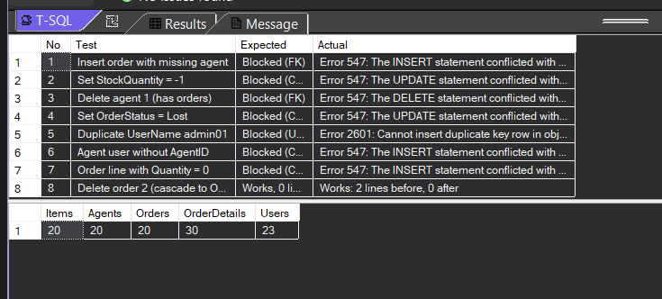

# Integrity test results (Task 2b)

- Database: B2BWholesaleDB (created with `Update-Database`, migration InitialCreate)
- Script: `Database/IntegrityTests.sql`
- Run by: Nguyễn Ngọc Qúy (524H0184)
- Date run: 19/11/2026
- Server: (localdb)\MSSQLLocalDB

Tests 1-7 must be blocked; test 8 (cascade) must work. Every test is rolled back, so the data is unchanged.

| No | Test | Expected | Actual (error number and message) | Result |
|----|------|----------|-----------------------------------|--------|
| 1 | Insert order with missing agent | Blocked (FK) | Error 547: INSERT statement conflicted with a constraint | Pass |
| 2 | Set StockQuantity = -1 | Blocked (CHECK) | Error 547: UPDATE statement conflicted with a constraint | Pass |
| 3 | Delete agent 1 (has orders) | Blocked (FK) | Error 547: DELETE statement conflicted with a constraint | Pass |
| 4 | Set OrderStatus = Lost | Blocked (CHECK) | Error 547: UPDATE statement conflicted with a constraint | Pass |
| 5 | Duplicate UserName admin01 | Blocked (UNIQUE) | Error 2601: cannot insert duplicate key row (unique index) | Pass |
| 6 | Agent user without AgentID | Blocked (CHECK) | Error 547: INSERT statement conflicted with a constraint | Pass |
| 7 | Order line with Quantity = 0 | Blocked (CHECK) | Error 547: INSERT statement conflicted with a constraint | Pass |
| 8 | Delete order 2 (cascade to OrderDetail) | Works, 0 lines left | Works: 2 lines before, 0 after | Pass |

Row counts after the tests (expected 20, 20, 20, 30, 23): Items = 20, Agents = 20, Orders = 20, OrderDetails = 30, Users = 23 (matches)

## Screenshot

